# Erster Funktionsnachweis (21. 11. 2026)

Durchgängiger Ablauf: Landform → Globus → Kontinent → vertiefter Ausschnitt → zurück.
Alle Bilder sind echte Godot-Ansichten. Erzeugt hat sie der Vorführmodus des Editors, der den
Ablauf selbst durchspielt:

```powershell
& $godot --path D:\WELTWERK -- --demo=D:\WELTWERK\docs\nachweis
```

Danach wurde das Programm neu gestartet (`--welt=…\welt.json`, Bild 11).

| | |
|---|---|
| 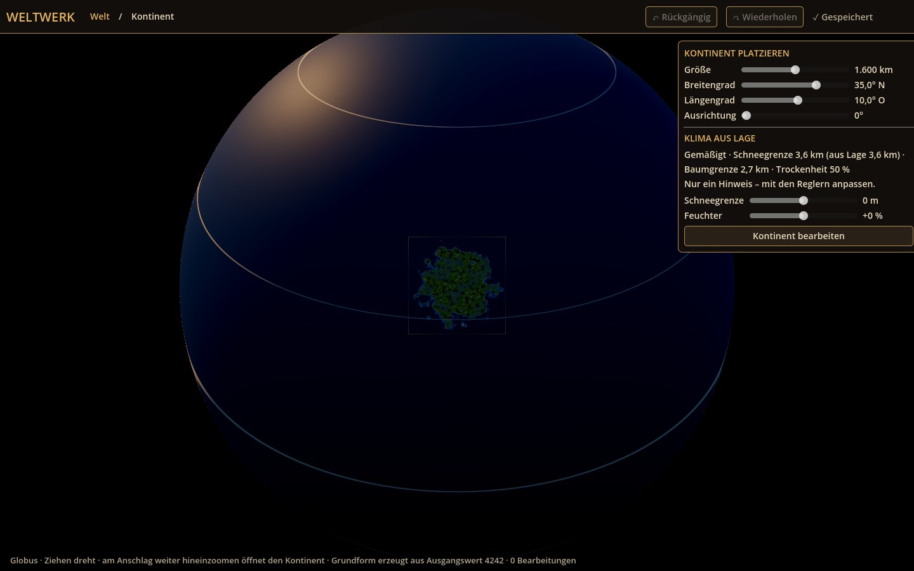 **1 Globus:** Kontinent platziert (Größe, Breite, Länge, Ausrichtung), „Klima aus Lage“ als Hinweis mit Reglern | 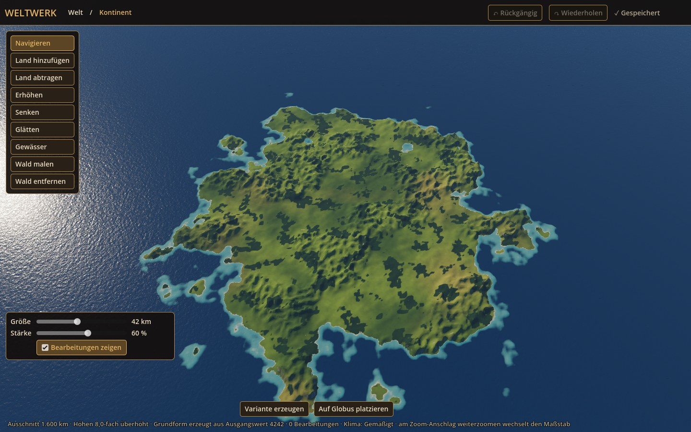 **2 Kontinent:** Grundform aus Ausgangswert, Werkzeuge links |
| 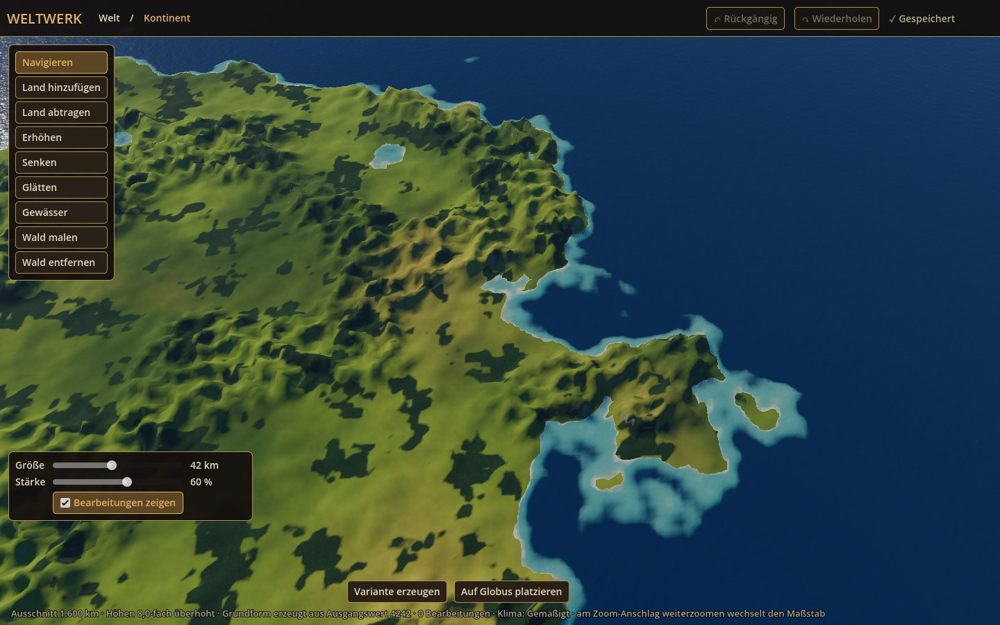 **3a Küste vorher** | 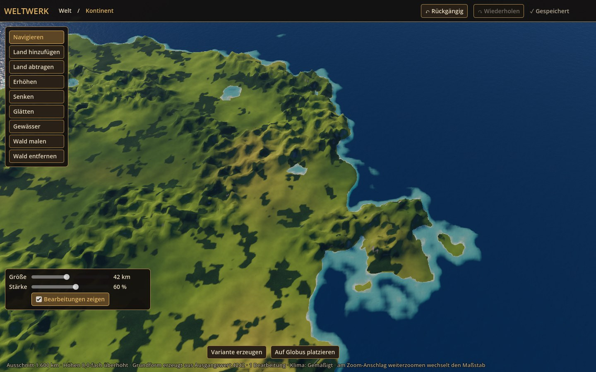 **3b Kontur geändert:** „Land hinzufügen“ füllt die Bucht |
| 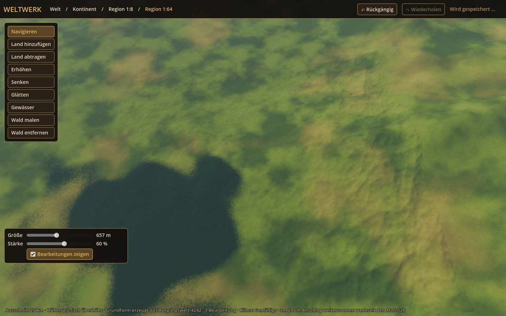 **4 Region 1:64 (25 km)**, übernimmt Küste, Höhen, Wald | 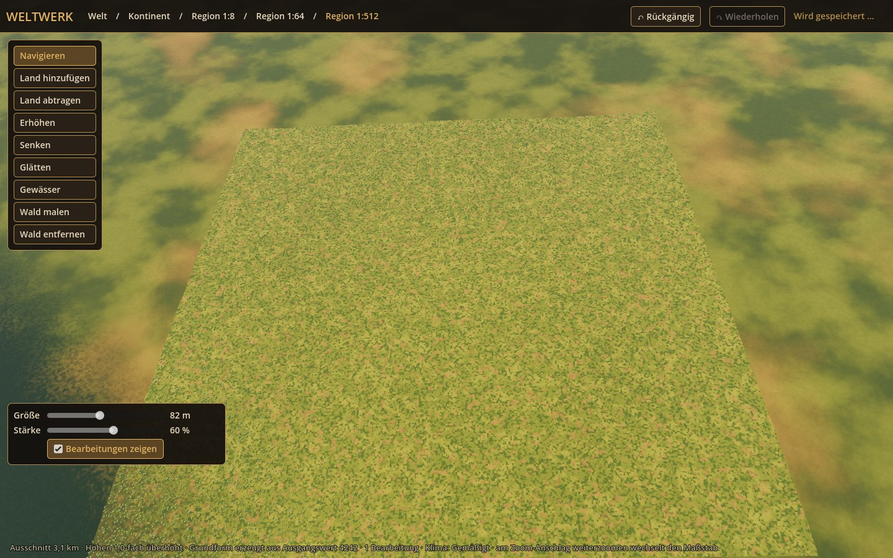 **5 Ausschnitt 1:512 (3,1 km)** mit Bäumen; drumherum der gröbere Ausschnitt als Umgebung |
| 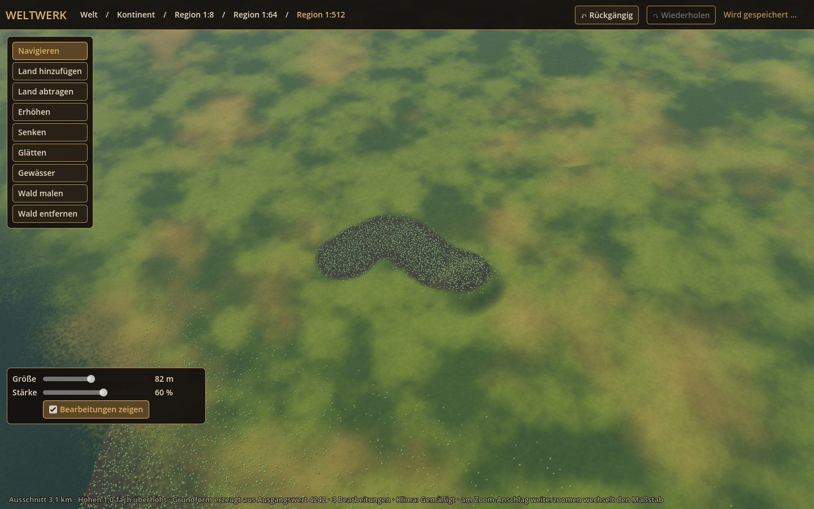 **6 Wald gemalt, Hügel erhöht** | 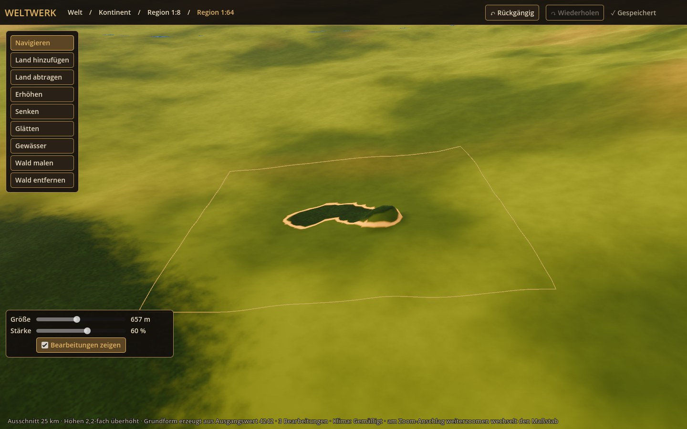 **7 Herausgezoomt (25 km):** Wald vereinfacht, Ort markiert, Rahmen des Ausschnitts |
| 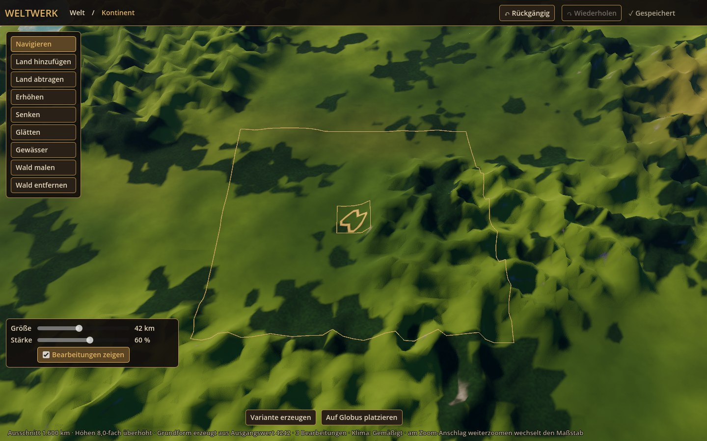 **8 Kontinent:** Rahmen der vertieften Bereiche, Bearbeitung markiert | 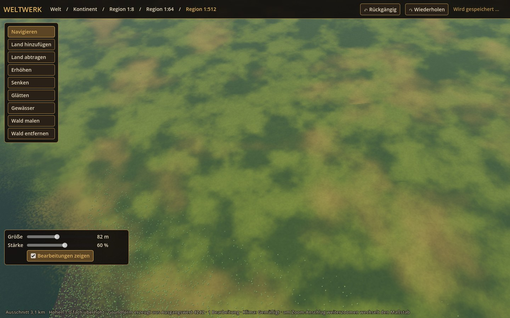 **9 Rückgängig** (Wald und Hügel weg) |
|  **10 Wiederholen** |  **11 Nach Neustart:** Kontur, Rahmen, Markierung, 3 Bearbeitungen erhalten |
| 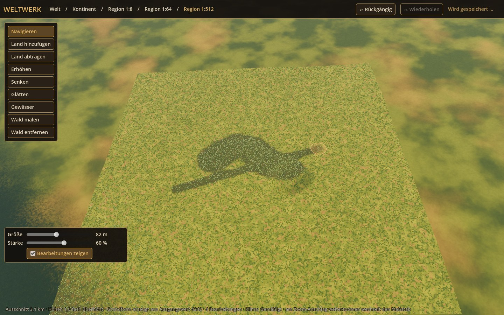 **12 Mit der Maus gemalt** (echte Eingabeereignisse, Pinselkreis sichtbar) | 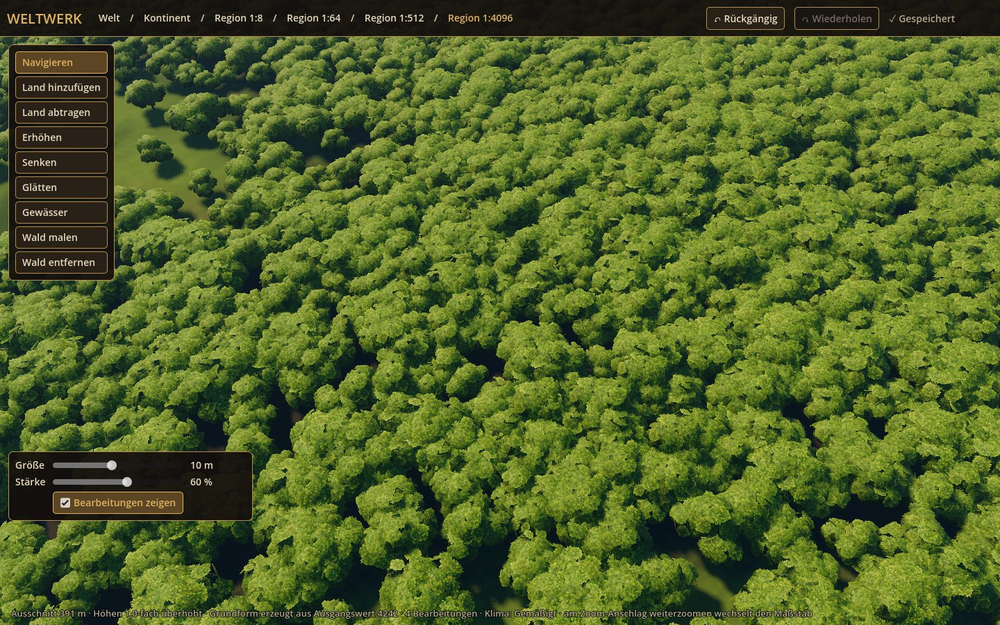 **13 Feinste Stufe 1:4096 (390 m):** Wald aus Blattkarten-Bäumen (Stiltest C) |

## Abnahme

| Punkt | Ergebnis | Nachweis |
|---|---|---|
| Kontur ändern | funktioniert | Bilder 3a/3b; Test `test_contour_change_carries_into_region` |
| Höhe oder Wald im Detail bearbeiten | funktioniert, auch mit der Maus | Bilder 6, 12 |
| Herauszoomen, Änderung am richtigen Ort | funktioniert: vereinfacht sichtbar, wo zu klein **messingfarben markiert**, vertiefte Bereiche als Rahmen | Bilder 7, 8; Test `test_detail_edit_found_again_when_zooming_out` (3 Maßstäbe, Ort und nur dort) |
| Speichern und Neustart | funktioniert: automatisch nach 0,4 s, erst vollständig schreiben, dann ersetzen | Bild 11; Test `test_save_and_load_keep_state` |
| Rückgängig/Wiederholen inkl. Abgeleitetem | funktioniert (Höhen, Wald, Bäume, Globusbild werden aus dem Stand neu berechnet) | Bilder 9/10; Tests `test_undo_redo_includes_derived_changes`, `test_placement_change_is_undoable` |
| Erzeugung wiederholbar | funktioniert | Test `test_generation_is_repeatable`; Bäume stehen je Weltzelle fest |
| Neue Variante überschreibt Handarbeit nicht | funktioniert (Striche bleiben obenauf) | Test `test_new_variant_keeps_hand_edits` |
| Leistung auf den Zielgeräten | **nur Windows-PC gemessen**, MacBook Air offen | unten |

Tests: 26 bestanden (`tests/run_tests.gd`).

## Messwerte (Windows-PC, RTX 2070 Super, 1440 × 900)

Szenengröße: Kontinent 1.600 km; jeder Ausschnitt 257 × 257 Punkte (66.049), Gitter 131.072
Dreiecke, Umgebung (gröberer Ausschnitt) gleich groß; Bäume nur in Ausschnitten bis 3,5 km.

| Ansicht | Bilder/s | Dreiecke im Bild | Grafikspeicher |
|---|---:|---:|---:|
| Globus | 595 | 0,74 Mio. | 228 MB |
| Kontinent (1.600 km) | 374 | 0,27 Mio. | 228 MB |
| Region 1:64 (25 km) | 310 | 0,92 Mio. | 233 MB |
| Ausschnitt 1:512 (3,1 km) mit Bäumen | 307 | 1,63 Mio. | 233 MB |
| Ausschnitt 1:4096 (390 m), Wald aus Blattkarten-Bäumen | 108 | 1,33 Mio. | 268 MB |

| Vorgang | Dauer |
|---|---:|
| Ausschnitt berechnen (je nach Feinheit) | 150–400 ms |
| Vertiefen (Ausschnitt + Umgebung) | 190–210 ms |
| Kontur ändern auf Kontinentebene | 150 ms |
| Strich per Befehl/Rückgängig (Ausschnitt + Umgebung neu) | ca. 600 ms je Strich |
| Malen mit der Maus, je Bild | 15 ms |
| Weltdatei mit 3 Strichen | 1,9 KB |

Arbeitsspeicher des Programms: 75–81 MB.

## Eingeschränkt

- **Maßstabswechsel springt sichtbar.** Am Zoom-Anschlag weiterzoomen öffnet ein Fenster mit 1/8
  der Größe; der gröbere Ausschnitt bleibt als Umgebung sichtbar. Für den flüssigen Übergang
  fehlen noch Kacheln mehrerer Feinheiten nebeneinander und ein Überblenden. Die Daten sind
  darauf ausgelegt.
- **Gewässer** trägt Land bis unter Meereshöhe ab. Seen über Meereshöhe und Flüsse entlang des
  Gefälles gibt es noch nicht.
- **Kontinentgröße ändern** skaliert nur die erzeugte Grundform. Striche bleiben in Metern an Ort
  und Stelle. Bis das geklärt ist: erst Größe festlegen, dann im Detail arbeiten.
- **Bäume** stehen nur im aktuellen Ausschnitt. In der Umgebung zeigt die Farbe den Wald, an der
  Fenstergrenze ist das als Kante zu sehen.
- **Rückgängig nach einem Strich** rechnet Ausschnitt und Umgebung neu (rund 0,6 s). Beim Malen
  selbst wird nur der Pinselbereich neu gerechnet.
- **Farben** sind eine Platzhalter-Palette. Die Bildsprache folgt der Entscheidung zum Stiltest.
- Nicht gebaut: Form als Linie zeichnen, Form importieren, Bereiche festsetzen, Konfliktanzeige
  vor einer Übernahme, mehrere Kontinente, Namen vergeben.

## Ungeprüft

- **MacBook Air**: vorerst nicht Zielgerät (Entscheidung des Spielleiters, 21. 11. 2026); dort
  ist nichts gemessen.
- Bedienung durch einen Menschen über längere Zeit (der Vorführmodus klickt nicht in die
  Oberfläche, er ruft dieselben Funktionen auf; nur das Malen läuft über echte Mausereignisse).

Die Weltdatei liegt unter `%APPDATA%\Godot\app_userdata\Weltwerk\welt.json` (macOS:
`~/Library/Application Support/Godot/app_userdata/Weltwerk/welt.json`).
