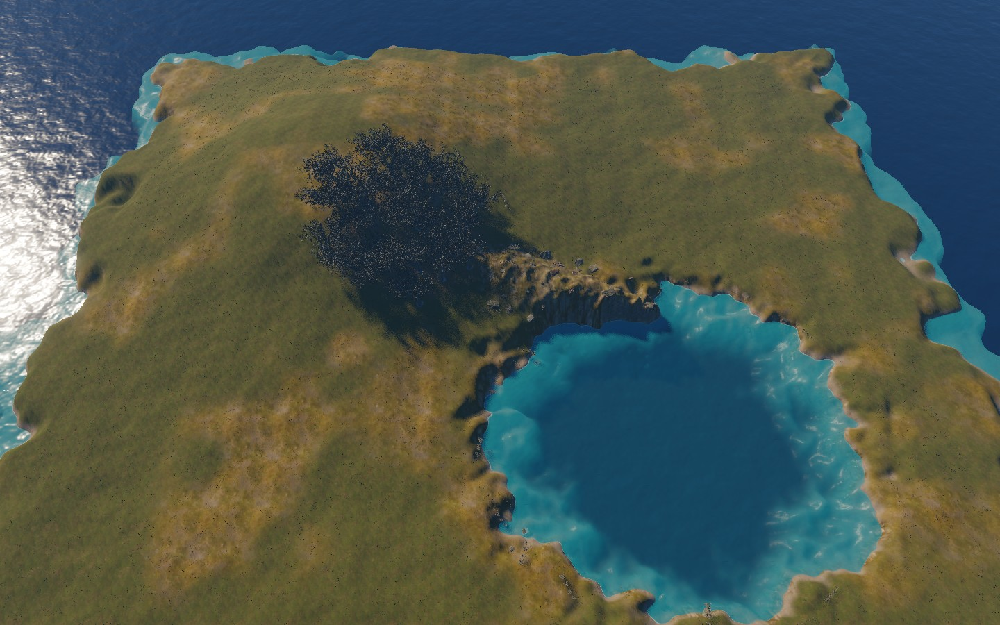
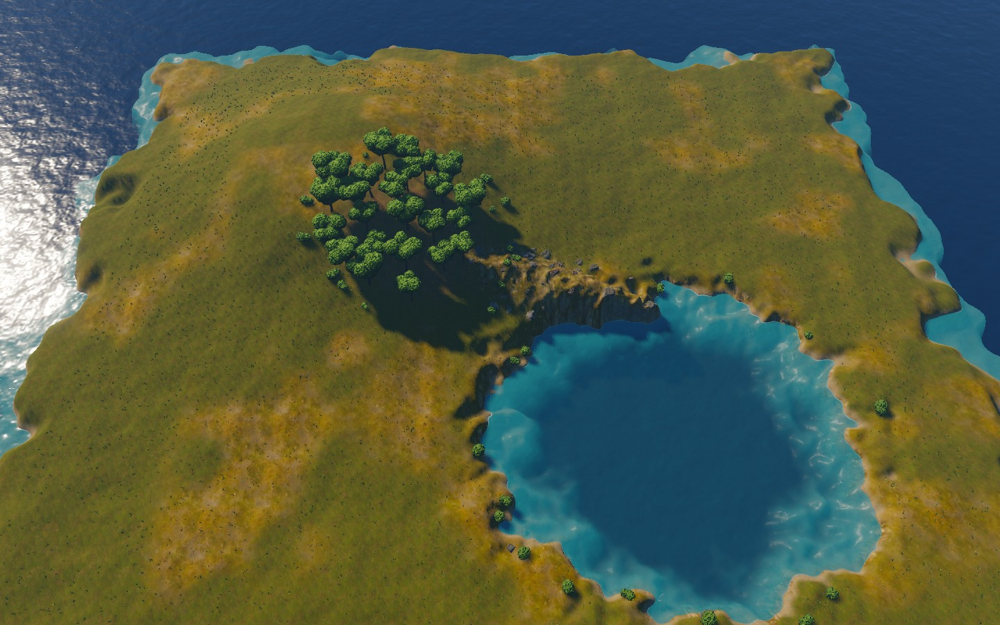
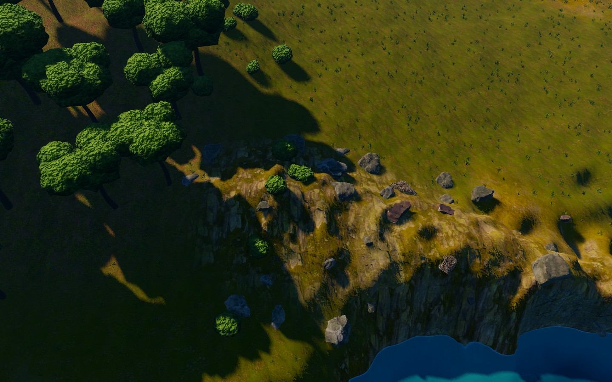

# Stiltest A/B (21. 11. 2026)

Dieselbe kleine Szene (Hügel, Felsufer, See, Wiese, Baumgruppe; 260 m × 260 m, davon ca.
170 m × 170 m gestaltet) in zwei Varianten. **Gleich** sind Geländeform, alle Positionen (fester
Zufall), Licht, Kamera (Winkel 52°, Arbeitsansicht 140 m Abstand, Nahansicht 34 m) und die
Geländetexturen. **Verschieden** sind die Modelle, die Laubmaterialien und die Farbanpassung
des Bodens.

- Szene: `scenes/style_test.tscn` (Tasten 1/2 Variante, 3/4 Ansicht, Maus/Trackpad wie gewohnt)
- Neu messen: `powershell -ExecutionPolicy Bypass -File tools\run_style_test.ps1`
- Bestand A laden: `tools\fetch_polyhaven.ps1` · Bestand B bauen: `tools\blender\make_style_b.py`

| | Arbeitsansicht | Nahansicht |
|---|---|---|
| **A** – Poly Haven unverändert |  |  |
| **B** – in Blender angepasst / selbst gebaut |  |  |

## Messwerte

Gemessen auf dem **Windows-PC (NVIDIA RTX 2070 Super)**, 1440 × 900, ohne Bildsynchronisation,
300 Bilder nach 90 Bildern Anlauf. Rohdaten: `docs/stiltest/*.json`.

| | Bilder/s | 95 % der Bilder schneller als | Dreiecke im Bild | Zeichenaufrufe | Grafikspeicher | Laden der Variante |
|---|---:|---:|---:|---:|---:|---:|
| A Arbeit | 25,6 | 39,7 ms | 126,5 Mio. | 71 | 385 MB | 0,33 s |
| A nah | 34,6 | 29,4 ms | 153,0 Mio. | 93 | 385 MB | 0,33 s |
| B Arbeit | 263,5 | 4,4 ms | 2,7 Mio. | 62 | 318 MB | 0,30 s |
| B nah | 354,0 | 3,4 ms | 3,4 Mio. | 79 | 318 MB | 0,30 s |

Bestand in der Szene: 24 Bäume, 40 Büsche, 46 Felsen, 6000 Grasbüschel (bei A und B gleich).
Grafikspeicher ist überwiegend Texturen (A 227–243 MB, B 227 MB): sechs Geländetexturen in 2k
mit je drei Karten.

**MacBook Air: nicht gemessen.** Grobe Schätzung (ungeprüft!): Die Grafik eines M-Chip-Air
leistet etwa ein Viertel bis ein Sechstel der RTX 2070, bei voller Bildschirmauflösung eher
weniger. B läge damit grob bei 40–60 Bildern/s, A bei 4–8. Erst eine Messung auf dem Air zählt.

## Herkunft und Nutzungsbedingungen

| Bestand | Quelle | Lizenz | Urheber | Größe |
|---|---|---|---|---|
| Geländetexturen `rocky_terrain_02`, `aerial_grass_rock`, `brown_mud_leaves_01`, `aerial_rocks_02`, `mossy_rock`, `coast_sand_01` (2k, je Farbe/Normale/AO-Rauheit) | polyhaven.com | CC0 – frei, auch kommerziell, ohne Namensnennung | Amal Kumar, Rob Tuytel, Rico Cilliers u. a. (Liste in `assets/external/polyhaven/sources.json`) | 59 MB |
| A: Baum `island_tree_02` (1,76 Mio. Polygone) | polyhaven.com | CC0 | Rob Tuytel, Rico Cilliers | 44 MB |
| A: Büsche `shrub_02`, `shrub_04`; Gras `grass_medium_02`; Felsen `rock_moss_set_02`, `boulder_01`, `rock_07` | polyhaven.com | CC0 | Rico Cilliers, Kless Gyzen, Jenelle van Heerden | 14 MB |
| B: Bäume `tree_b_1–3`, Büsche `bush_b_1–2`, Gras `grass_b_1–2` | selbst gebaut mit Blender 5.2 per Skript, fester Ausgangswert | eigenes Werk (Weltwerk) | – | 1 MB |
| B: Felsen `*_b.glb` | aus den Poly-Haven-Felsen ausgedünnt (Blender) | CC0-Grundlage, Bearbeitung eigen | wie oben | 7 MB |

Die heruntergeladenen Dateien liegen nicht im Repository (`assets/external/` ist ausgeschlossen),
sondern lassen sich mit dem Ladeskript jederzeit wiederherstellen. Die B-Modelle sind klein und
im Repository.

## Herstellungsaufwand (tatsächlich)

- **A:** Suche und Auswahl über die Poly-Haven-Schnittstelle, Download (75 MB, 33 s),
  Godot-Import (35 s). Danach Nacharbeit: erste Texturwahl war farblich falsch (beige statt grün),
  Normalenkarten mussten als solche markiert werden, und die automatische Vereinfachung (LOD) hat
  das Laub der Bäume weggerechnet – deshalb ist sie für Baum und Gras abgeschaltet, was den Preis
  von über 120 Mio. Dreiecken erklärt. Meine Arbeitszeit: etwa 20 Minuten.
- **B:** ein Blender-Skript (ca. 250 Zeilen) für Bäume, Büsche, Gras und das Ausdünnen der
  Felsen; Laufzeit 3,5 s. Zwei Laub-Shader in Godot. Nacharbeit: Eckpunktfarben wurden zuerst
  nicht exportiert (weiße Bäume). Meine Arbeitszeit: etwa 15 Minuten.
- Gemeinsam (Szene, Geländeform, Messung, Bericht): etwa 25 Minuten.
- **Higgsfield** wurde nicht benutzt: Das Programm ist auf dem PC nicht installiert, und die
  Installation läuft über ein Skript aus dem Internet – das starte ich nicht ohne dein Okay.

## Einschätzung

- **Gelände:** Die Poly-Haven-Fototexturen tragen. Aus der Arbeitsansicht wirken sie natürlich
  und recht nah an deinen Kartenbildern; die Farbanpassung von B (wärmer, kräftiger) passt besser
  zu den Zielbildern als die unveränderten Farben. Aus der Nähe fehlt noch Detail
  (Kachelwiederholung sichtbar, Übergänge weich) – das ist Shaderarbeit, keine Bestandsfrage.
- **Felsen:** In beiden Varianten brauchbar. Ausgedünnt (B) ist kein Unterschied zu sehen, der
  Preis aber ein Zehntel.
- **Bäume sind die eigentliche Frage.** A ist echt, aber im Bild fast schwarz und unbezahlbar
  (1,76 Mio. Polygone pro Baum; die Vereinfachung zerstört das Laub). B ist lesbar und billig
  (2.200–2.500 Dreiecke), wirkt aber wie Watte/Brokkoli und bleibt hinter den Zielbildern zurück.
- **Gras:** A kaum sichtbar, B als Halme erkennbar. Aus der Arbeitsansicht trägt ohnehin die
  Bodentextur.

## Empfehlung (zur Entscheidung)

Weder A noch B unverändert, sondern: **Gelände und Felsen wie B** (Poly-Haven-Texturen mit
Farbanpassung, ausgedünnte Poly-Haven-Felsen). **Für Bäume einen dritten Weg testen:** Bäume mit
echten Blattflächen (Blattbüschel als Flächen mit Blatttextur, z. B. aus Poly-Haven-Laub) und
fertigen Detailstufen bis hin zur Bildtafel für die Ferne – entweder selbst in Blender gebaut oder
aus einem dafür gemachten Spielepaket (Lizenz prüfen). Higgsfield könnte Referenzbilder und
gemalte Texturen liefern, sobald es eingerichtet ist.
