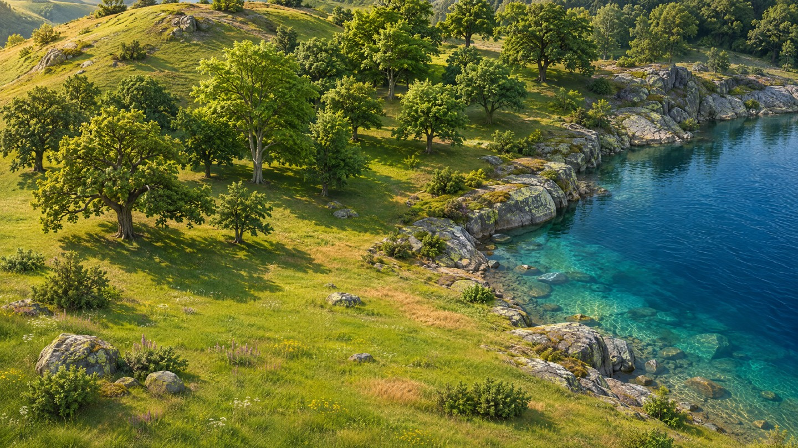
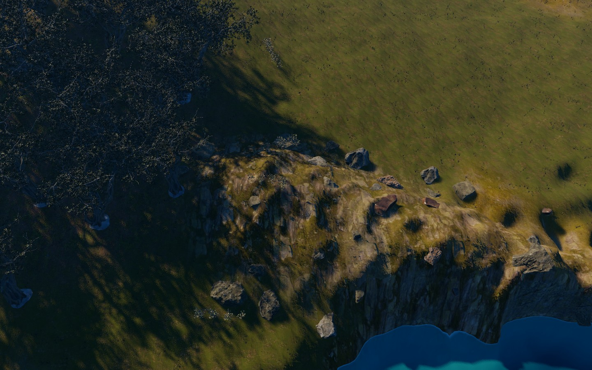
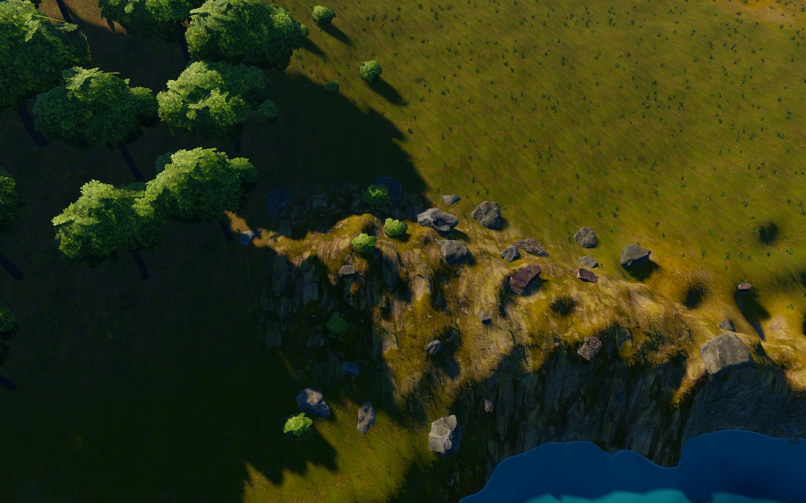

# Stiltest A/B/C (21. 11. 2026)

Dieselbe kleine Szene (Hügel, Felsufer, See, Wiese, Baumgruppe; 260 m × 260 m, davon ca.
170 m × 170 m gestaltet) in drei Varianten. **Gleich** sind Geländeform, alle Positionen (fester
Zufall), Licht, Kamera (Winkel 52°, Arbeitsansicht 140 m Abstand, Nahansicht 34 m) und die
Geländetexturen. **Verschieden** sind die Modelle, die Laubmaterialien und die Farbanpassung
des Bodens.

- Szene: `scenes/style_test.tscn` (Tasten 1/2/3 Variante, 4/5 Ansicht, Maus/Trackpad wie gewohnt)
- Neu messen: `powershell -ExecutionPolicy Bypass -File tools\run_style_test.ps1` (Fenster auf dem
  rechten Bildschirm)
- Bestand A laden: `tools\fetch_polyhaven.ps1` · B bauen: `tools\blender\make_style_b.py` ·
  C bauen: `tools\blender\make_style_c.py`

**Zielbild** (mit Higgsfield erzeugt, nur als Richtung – kein Kanon):

| | Arbeitsansicht | Nahansicht |
|---|---|---|
| **A** – Poly Haven unverändert |  |  |
| **B** – in Blender angepasst / selbst gebaut |  |  |
| **C** – wie B, Bäume und Büsche aus Blattkarten mit Higgsfield-Laub |  |  |

Im Editor (feinster Ausschnitt, 390 m) sieht ein Wald aus C-Bäumen so aus:

## Messwerte

Gemessen auf dem **Windows-PC (NVIDIA RTX 2070 Super)**, 1440 × 900, ohne Bildsynchronisation,
300 Bilder nach 90 Bildern Anlauf. Rohdaten: `docs/stiltest/*.json`. Zielgerät ist vorerst nur
dieser PC (Entscheidung des Spielleiters, 21. 11. 2026).

| | Bilder/s | 95 % der Bilder schneller als | Dreiecke im Bild | Zeichenaufrufe | Grafikspeicher | Laden der Variante |
|---|---:|---:|---:|---:|---:|---:|
| A Arbeit | 25,6 | 39,7 ms | 126,5 Mio. | 71 | 385 MB | 0,33 s |
| A nah | 34,6 | 29,4 ms | 153,0 Mio. | 93 | 385 MB | 0,33 s |
| B Arbeit | 263,5 | 4,4 ms | 2,7 Mio. | 62 | 318 MB | 0,30 s |
| B nah | 354,0 | 3,4 ms | 3,4 Mio. | 79 | 318 MB | 0,30 s |
| C Arbeit | 229,9 | 6,8 ms | 2,6 Mio. | 68 | 326 MB | 0,85 s* |
| C nah | 303,0 | 5,8 ms | 3,1 Mio. | 89 | 325 MB | 0,34 s |

\* erster Lauf mit Laden des Laubatlas.

Bestand in der Szene: 24 Bäume, 40 Büsche, 46 Felsen, 6000 Grasbüschel (bei allen gleich).
Grafikspeicher ist überwiegend Texturen: sechs Geländetexturen in 2k mit je drei Karten.
Ein Baum kostet: A 1,76 Mio. Polygone · B 2.200–2.500 Dreiecke · C 1.000–1.200 Dreiecke.

## Herkunft und Nutzungsbedingungen

| Bestand | Quelle | Lizenz | Urheber | Größe |
|---|---|---|---|---|
| Geländetexturen `rocky_terrain_02`, `aerial_grass_rock`, `brown_mud_leaves_01`, `aerial_rocks_02`, `mossy_rock`, `coast_sand_01` (2k, je Farbe/Normale/AO-Rauheit) | polyhaven.com | CC0 – frei, auch kommerziell, ohne Namensnennung | Amal Kumar, Rob Tuytel, Rico Cilliers u. a. (Liste in `assets/external/polyhaven/sources.json`) | 59 MB |
| A: Baum `island_tree_02` (1,76 Mio. Polygone) | polyhaven.com | CC0 | Rob Tuytel, Rico Cilliers | 44 MB |
| A: Büsche `shrub_02`, `shrub_04`; Gras `grass_medium_02`; Felsen `rock_moss_set_02`, `boulder_01`, `rock_07` | polyhaven.com | CC0 | Rico Cilliers, Kless Gyzen, Jenelle van Heerden | 14 MB |
| B: Bäume `tree_b_1–3`, Büsche `bush_b_1–2`, Gras `grass_b_1–2` | selbst gebaut mit Blender 5.2 per Skript, fester Ausgangswert | eigenes Werk (Weltwerk) | – | 1 MB |
| B/C: Felsen `*_b.glb` | aus den Poly-Haven-Felsen ausgedünnt (Blender) | CC0-Grundlage, Bearbeitung eigen | wie oben | 7 MB |
| C: Laubatlas `leaf_atlas.png` (2 × 2 Buchen-/Eichenbüschel, 2048², transparent) | mit **Higgsfield** erzeugt (GPT Image 2.6, Qualität hoch, 2 Guthaben) | Nutzungsrechte nach den Higgsfield-Bedingungen deines Kontos (Starter-Plan) – **vor einer Veröffentlichung prüfen** | – | 5 MB |
| C: Bäume `tree_c_1–3`, Büsche `bush_c_1–2` | selbst gebaut mit Blender 5.2 per Skript, fester Ausgangswert | eigenes Werk | – | 0,3 MB |
| Zielbild | mit Higgsfield erzeugt (2 Guthaben) | wie Laubatlas; nur Referenz | – | – |

Die heruntergeladenen Poly-Haven-Dateien liegen nicht im Repository (`assets/external/` ist
ausgeschlossen), sondern lassen sich mit dem Ladeskript jederzeit wiederherstellen. Die eigenen
Modelle und der Laubatlas sind im Repository; die Higgsfield-Originale liegen nur lokal in
`assets/style_c/source/` und bei Higgsfield in deinem Konto.

## Herstellungsaufwand (tatsächlich)

- **A:** Suche und Auswahl über die Poly-Haven-Schnittstelle, Download (75 MB, 33 s),
  Godot-Import (35 s). Danach Nacharbeit: erste Texturwahl war farblich falsch (beige statt grün),
  Normalenkarten mussten als solche markiert werden, und die automatische Vereinfachung (LOD) hat
  das Laub der Bäume weggerechnet – deshalb ist sie für Baum und Gras abgeschaltet, was den Preis
  von über 120 Mio. Dreiecken erklärt. Meine Arbeitszeit: etwa 20 Minuten.
- **B:** ein Blender-Skript (ca. 250 Zeilen) für Bäume, Büsche, Gras und das Ausdünnen der
  Felsen; Laufzeit 3,5 s. Zwei Laub-Shader in Godot. Nacharbeit: Eckpunktfarben wurden zuerst
  nicht exportiert (weiße Bäume). Meine Arbeitszeit: etwa 15 Minuten.
- **C:** Higgsfield-Programm installiert (offizielle Windows-Fassung 1.2.3, Prüfsumme und Signatur
  geprüft), Laubatlas und Zielbild erzeugt (je rund 1 Minute, zusammen 4 Guthaben), ein
  Blender-Skript (ca. 200 Zeilen, Laufzeit 3 s) und ein Blattkarten-Shader. Gleich im ersten
  Anlauf brauchbar. Meine Arbeitszeit: etwa 20 Minuten.
- Gemeinsam (Szene, Geländeform, Messung, Bericht): etwa 25 Minuten.

## Einschätzung

- **Gelände:** Die Poly-Haven-Fototexturen tragen. Die Farbanpassung von B/C (wärmer, kräftiger)
  passt besser zu den Zielbildern. Aus der Nähe fehlt Detail gegenüber dem Zielbild (Blumen,
  Grashalme, Übergänge) – das ist Shader- und Bewuchsarbeit, keine Bestandsfrage.
- **Felsen:** brauchbar; ausgedünnt kein sichtbarer Unterschied bei einem Zehntel des Preises.
- **Bäume:** A ist echt, aber fast schwarz und unbezahlbar. B ist billig, aber Watte. **C trifft
  die Richtung des Zielbilds** – echtes Laub, weiches Kronenvolumen – und ist billiger als B.
  Was noch fehlt: lockerere Kronen mit mehr Lücken und sichtbaren Ästen, mehr Baumarten (auch
  Nadelbäume), und für sehr viele Bäume eine Bildtafel als ferne Detailstufe.
- **Gras:** B/C als Halme erkennbar; aus der Arbeitsansicht trägt die Bodentextur.

## Empfehlung (zur Entscheidung)

**Variante C als Grundlage:** Poly-Haven-Geländetexturen mit Farbanpassung, ausgedünnte
Poly-Haven-Felsen, Bäume und Büsche aus Blattkarten (Blender-Skript + Higgsfield-Laub). Nächste
Schritte dafür: Nadelbaum-Atlas und weitere Laubarten über Higgsfield, lockerere Kronen,
Bildtafeln für die Ferne, Bodendetail (Blumen, Halme) näher am Zielbild.
