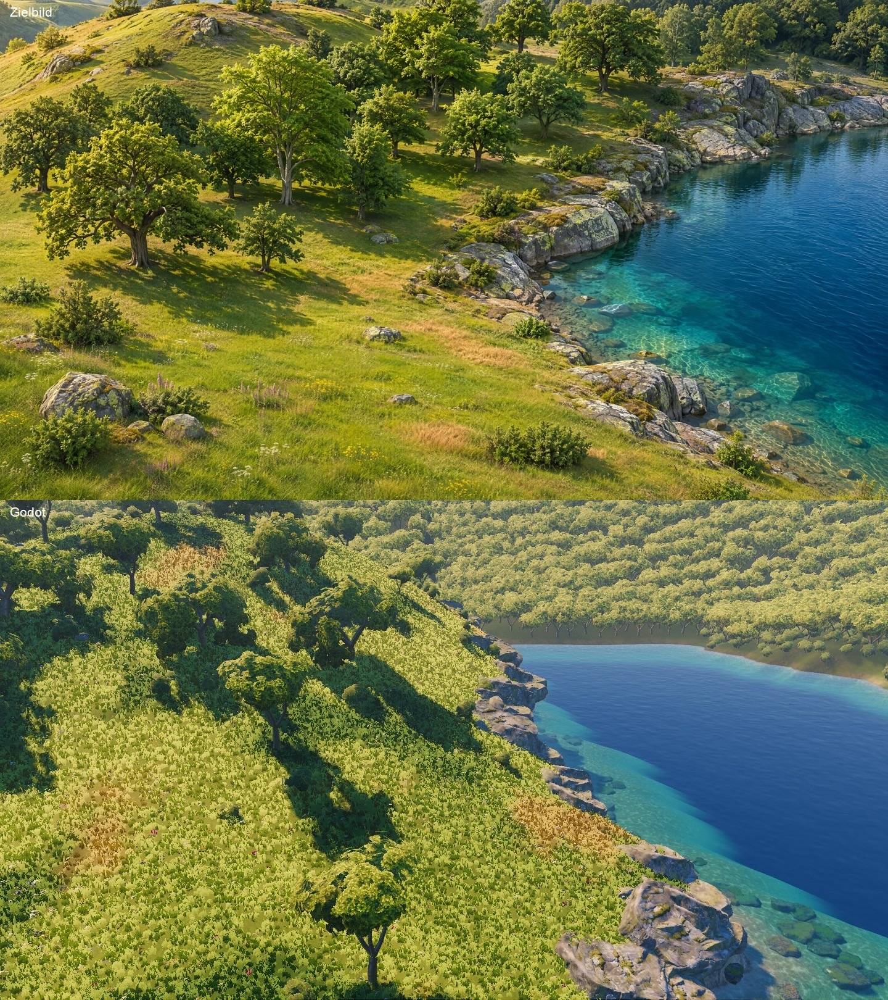
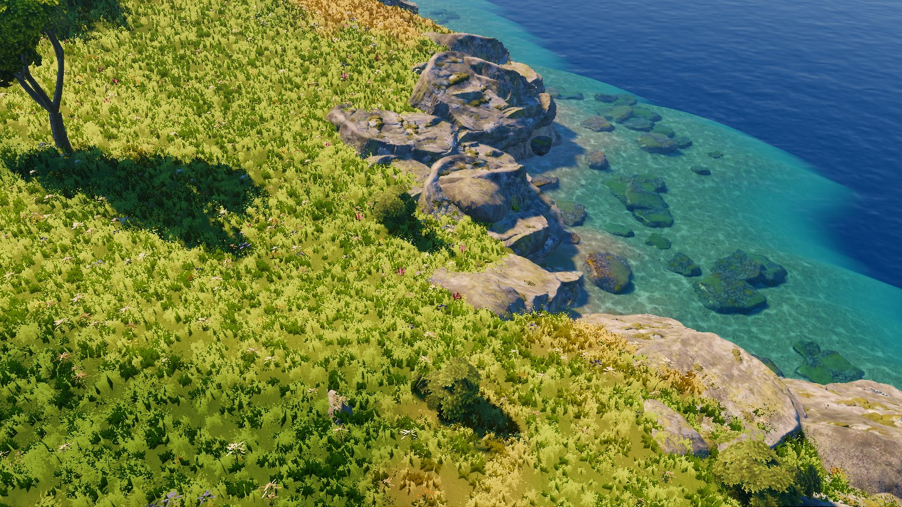
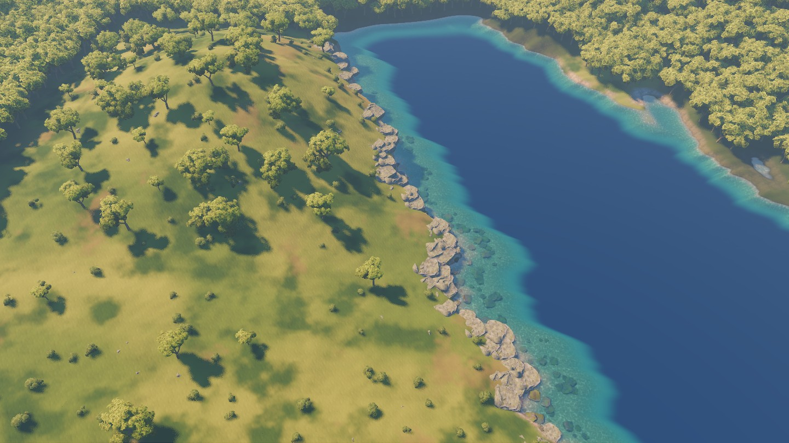
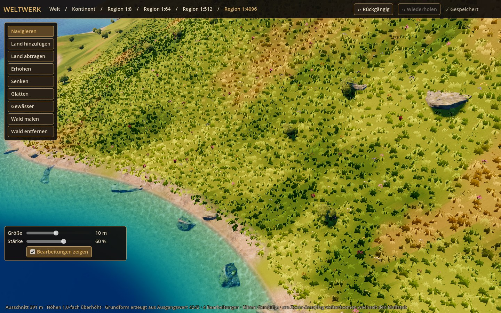

# Weg zum Zielbild (21. 11. 2026)

Ziel: das bestätigte Zielbild (`docs/stiltest/zielbild_higgsfield.jpg`). Die Arbeit lief in zwei
Teilen. Zuerst eine **Zielszene** (`scenes/target_scene.tscn`), die wie das Zielbild aufgebaut
ist. Sie wurde in 21 Runden gebaut, gemessen und jedes Mal neben das Zielbild gestellt.
Danach wurde das Ergebnis in die **feinsten Ausschnitte des Editors** übertragen.

## Stand



| Nahansicht | Arbeitsansicht |
|---|---|
|  |  |

Im Editor, Ausschnitt 1:4096 (390 m) an einer erzeugten Küste:


Alle Runden liegen in `docs/ziel/vergleich_ziel_r1.jpg` bis `…_r21.jpg`.

## Was erreicht ist

- **Wiese:** sattgrün mit gelbgrünen Sonnenflecken, trockenen Stellen und verstreuten
  Wildblumen. Boden und Grasbüschel nutzen dieselbe Farbpalette (`src/target/meadow.gdshaderinc`),
  dadurch passen sie zusammen.
- **Bäume:** Eichen, Buchen und junge Bäume mit verzweigten Ästen und Blattkarten aus einem
  sonnigen Higgsfield-Laubatlas. Im Hintergrund ein dichter Wald aus einfachen Fernbäumen mit
  Unterholz am Rand.
- **Felsen:** zwei 3D-Granitfelsen von Higgsfield mit Flechten und Moos, gestreckt zu
  Uferbänken und Findlingen.
- **Wasser:** klar, mit Lichtbrechung und Lichtmustern am Grund. Im Flachen türkis mit
  sichtbaren Steinen, in der Tiefe dunkelblau.
- **Licht:** warme Sonne von links hinten, weiche Verschattung.
- **Editor:** In Ausschnitten bis 3,6 km gelten derselbe Boden und das klare Wasser. Bis 450 m
  kommen Zielbäume, Felsen am Ufer, Büsche, Gras und Blumen dazu, alles fest je Weltzelle
  platziert. Die Kamera wird beim Hineinzoomen flacher (52° → 30°), damit Gras und Bäume wie
  im Zielbild von der Seite zu sehen sind. Drehen bleibt ausgeschlossen.

## Was noch abweicht

- Die Kronen sind noch etwas zu rund und gleichförmig. Im Zielbild sind sie lockerer, mit
  sichtbaren Ästen und Himmel dazwischen.
- Die Grashalme sind gröber als im Zielbild. Feine Halmrichtung und Wind-„Kämmung“ fehlen.
- Am Gegenufer sieht man stellenweise noch Stammreihen.
- Uferbänke entstehen im Editor nur, wo das erzeugte Ufer steil genug ist. Flache Ufer werden
  zu Sandsaum. Wer felsige Ufer will, braucht später ein Werkzeug „Felsen“.
- Leichte Streifen im Hangschatten (Schattenauflösung bei flacher Sonne).

## Messwerte (Windows-PC, RTX 2070 Super, 1440 × 810 bzw. 1440 × 900)

| Ansicht | Bilder/s | Dreiecke im Bild |
|---|---:|---:|
| Zielszene, Zielansicht | 61 | 6,1 Mio. |
| Zielszene, Nahansicht | 72 | 6,0 Mio. |
| Editor, Ufer 1:4096 | 142 | 2,4 Mio. |
| Editor, dichter Wald 1:4096 | 38 | 2,0 Mio. (viel Überdeckung durch Blattkarten) |

Aufbau der Zielszene: rund 5 s, darin 230.000 Grasbüschel, 13.000 Blumen und 6.500
Hintergrundbäume. Einen 390-m-Ausschnitt im Editor zu erzeugen dauert 1,7–2,2 s, weil Gras
und Blumen dazukommen.

## Bestand und Kosten

| Bestand | Quelle | Kosten |
|---|---|---:|
| Gras-, Blumen-, Strauch-Atlas, Flechtengranit-Textur, Felsvorlage | Higgsfield GPT Image 2.6 | 10 Guthaben |
| Sonniger Laubatlas | Higgsfield GPT Image 2.6 | 2 Guthaben |
| Granitfels 1 (3D) | Higgsfield Multi-Image to 3D | 30 Guthaben |
| Felsvorlage 2 und Granitfels 2 (3D) | Higgsfield | 32 Guthaben |
| Laubatlas Stiltest C, Zielbild | Higgsfield | 4 Guthaben |
| Bäume, Büsche, Fernbäume | eigenes Blender-Skript `tools/blender/make_target_assets.py` | – |
| Boden-, Fels-, Rinden-, Seegrund-Texturen | Poly Haven (CC0) | – |

Zusammen 78 Higgsfield-Guthaben, der Kontostand liegt jetzt bei 561,85. Alle Anweisungen und
Auftragsnummern stehen in `assets/target/source/generated.json` bzw. den `rock_3d_job*.json`.
Die Nutzungsrechte an Higgsfield-Erzeugnissen richten sich nach den Bedingungen deines Kontos
und sind vor einer Veröffentlichung zu prüfen.

## Befehle

```powershell
powershell -ExecutionPolicy Bypass -File tools\run_target.ps1 -Tag runde22          # Zielansicht + Vergleich
powershell -ExecutionPolicy Bypass -File tools\run_target.ps1 -Views nah -Tag runde22
& $godot --position 2000,60 --path D:\WELTWERK res://scenes/target_scene.tscn      # ansehen (1/2/3)
```
